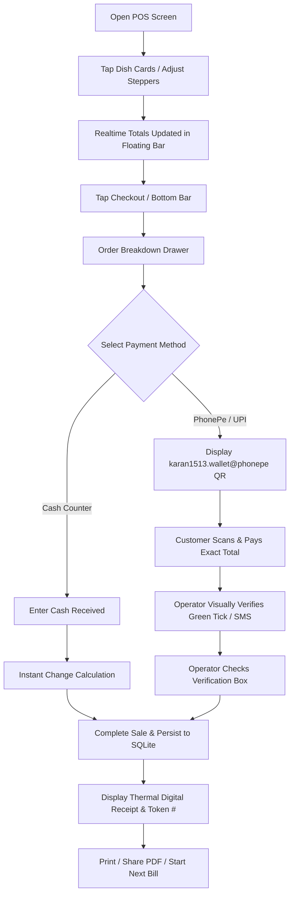

# Snacks O'Clock — Billing & Payment Lifecycle

## 1. Quick POS Workflow (Under 10 Seconds Per Customer)

---

## 2. Validation & Safety Rules

1. **No Zero/Empty Bills:** Checkout CTA is disabled whenever cart quantity is 0.
2. **Negative Quantities Blocked:** Stepper minimum is 0 (tapping minus on 1 removes the item from cart).
3. **Cash Tender Validation:** If entered cash < payable amount, checkout button remains disabled and highlights insufficient tender.
4. **Duplicate Submission Lock:** The "Complete Order" trigger initiates an atomic write and disables re-entry until navigation transition finishes.
5. **Atomic Transaction:** The bill header and all line items write inside a single SQLite transaction block.
